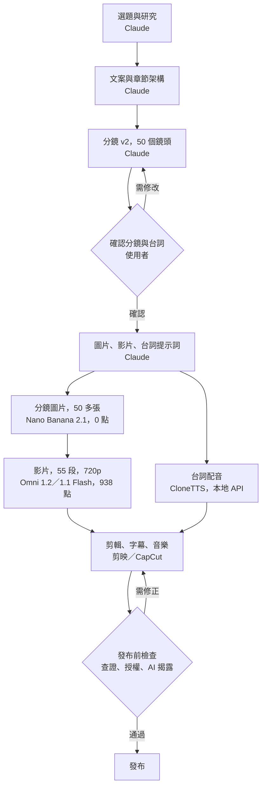

# 《晶片的誕生》製作紀錄 production_log

## 1. 專案資訊

| 項目 | 內容 |
|---|---|
| 片名 | 晶片的誕生 |
| 類型 | AI 電影級科普影片 |
| 受眾 | 大學生，兼顧老師的教學使用 |
| 成片長度 | 6 分 20 秒（開場 45 秒、六章 4 分 55 秒、結語 40 秒） |
| 分鏡 | 50 個鏡頭，生成 55 段影片（5 個標題鏡頭拆成 a、b 兩段） |
| 畫面 | 16:9，影片輸出 720p |
| 聲音設計 | 影片只有背景音，台詞另外配音 |
| 轉場原則 | 只用運鏡銜接與匹配轉換，各章標題融入畫面元素 |

## 2. 製作流程與工具

| 階段 | 工具 | 成果 |
|---|---|---|
| 選題與研究 | Claude | 選定《晶片的誕生》 |
| 文案與章節架構 | Claude | 開場、六章、結語 |
| 分鏡 v2 | Claude | 50 個連續運鏡鏡頭 |
| 圖片提示詞、影片與運鏡提示詞 | Claude | chip_birth_image_prompts.md、chip_birth_video_prompts.md |
| 台詞 | Claude，使用者修訂 | chip_birth_narration.md |
| 分鏡圖片 | Gemini，Nano Banana 2.1，16:9 | 50 多張靜態圖 |
| 影片生成 | Gemini，Omni 1.2 Flash 與 1.1 Flash，720p，首尾幀 | 55 段影片 |
| 配音 | CloneTTS，本地自架 API | 旁白音檔 |
| 剪輯、字幕、音樂 | 剪映／CapCut | 成片 |

### 流程圖

## 3. 額度與花費

- **方案**：Gemini Pro，影片月額度 1,000 點、每日上限 50 點。
- **圖片**：50 多張，0 點。
- **影片**：938 點，55 段。
- **重抽**：使用者回報只有一兩次，約 12 到 48 點。
- **合計**：約 950 到 986 點，用掉月額度約 95% 到 99%。

| 階段 | 模型 | 段數 | 點數 |
|---|---|---|---|
| S01–S28 | Omni 1.2 Flash | 32 | 672 |
| S29–S50 | Omni 1.1 Flash | 23 | 266 |
| 合計 | | 55 | 938 |

**點數優化**：後半改用 Omni 1.1 Flash。若全程使用 1.2 Flash，後半需 528 點，總計 1,200 點，超過月額度。實際省下 262 點，約 22%。

## 4. 逐段素材紀錄

「重抽」與「審核」兩欄待補，生成與剪輯時填入。

| 片段 | 模型 | 生成長度 | 點數 | 重抽 | 審核 |
|---|---|---|---|---|---|
| S01 | Omni 1.2 Flash | 8 秒 | 24 | | |
| S02 | Omni 1.2 Flash | 8 秒 | 24 | | |
| S03 | Omni 1.2 Flash | 8 秒 | 24 | | |
| S04 | Omni 1.2 Flash | 8 秒 | 24 | | |
| S05 | Omni 1.2 Flash | 8 秒 | 24 | | |
| S06 | Omni 1.2 Flash | 8 秒 | 24 | | |
| S07a | Omni 1.2 Flash | 4 秒 | 12 | | |
| S07b | Omni 1.2 Flash | 4 秒 | 12 | | |
| S08 | Omni 1.2 Flash | 8 秒 | 24 | | |
| S09 | Omni 1.2 Flash | 8 秒 | 24 | | |
| S10 | Omni 1.2 Flash | 8 秒 | 24 | | |
| S11 | Omni 1.2 Flash | 8 秒 | 24 | | |
| S12a | Omni 1.2 Flash | 4 秒 | 12 | | |
| S12b | Omni 1.2 Flash | 4 秒 | 12 | | |
| S13 | Omni 1.2 Flash | 8 秒 | 24 | | |
| S14 | Omni 1.2 Flash | 8 秒 | 24 | | |
| S15 | Omni 1.2 Flash | 8 秒 | 24 | | |
| S16 | Omni 1.2 Flash | 8 秒 | 24 | | |
| S17 | Omni 1.2 Flash | 8 秒 | 24 | | |
| S18a | Omni 1.2 Flash | 4 秒 | 12 | | |
| S18b | Omni 1.2 Flash | 4 秒 | 12 | | |
| S19 | Omni 1.2 Flash | 8 秒 | 24 | | |
| S20 | Omni 1.2 Flash | 8 秒 | 24 | | |
| S21 | Omni 1.2 Flash | 8 秒 | 24 | | |
| S22 | Omni 1.2 Flash | 8 秒 | 24 | | |
| S23 | Omni 1.2 Flash | 8 秒 | 24 | | |
| S24a | Omni 1.2 Flash | 4 秒 | 12 | | |
| S24b | Omni 1.2 Flash | 4 秒 | 12 | | |
| S25 | Omni 1.2 Flash | 8 秒 | 24 | | |
| S26 | Omni 1.2 Flash | 8 秒 | 24 | | |
| S27 | Omni 1.2 Flash | 8 秒 | 24 | | |
| S28 | Omni 1.2 Flash | 8 秒 | 24 | | |
| S29a | Omni 1.1 Flash | 4 秒 | 7 | | |
| S29b | Omni 1.1 Flash | 4 秒 | 7 | | |
| S30 | Omni 1.1 Flash | 8 秒 | 12 | | |
| S31 | Omni 1.1 Flash | 8 秒 | 12 | | |
| S32 | Omni 1.1 Flash | 8 秒 | 12 | | |
| S33 | Omni 1.1 Flash | 8 秒 | 12 | | |
| S34 | Omni 1.1 Flash | 8 秒 | 12 | | |
| S35 | Omni 1.1 Flash | 8 秒 | 12 | | |
| S36 | Omni 1.1 Flash | 8 秒 | 12 | | |
| S37 | Omni 1.1 Flash | 8 秒 | 12 | | |
| S38 | Omni 1.1 Flash | 8 秒 | 12 | | |
| S39 | Omni 1.1 Flash | 8 秒 | 12 | | |
| S40 | Omni 1.1 Flash | 8 秒 | 12 | | |
| S41 | Omni 1.1 Flash | 8 秒 | 12 | | |
| S42 | Omni 1.1 Flash | 8 秒 | 12 | | |
| S43 | Omni 1.1 Flash | 8 秒 | 12 | | |
| S44 | Omni 1.1 Flash | 8 秒 | 12 | | |
| S45 | Omni 1.1 Flash | 8 秒 | 12 | | |
| S46 | Omni 1.1 Flash | 8 秒 | 12 | | |
| S47 | Omni 1.1 Flash | 8 秒 | 12 | | |
| S48 | Omni 1.1 Flash | 8 秒 | 12 | | |
| S49 | Omni 1.1 Flash | 8 秒 | 12 | | |
| S50 | Omni 1.1 Flash | 8 秒 | 12 | | |

## 5. 相關檔案

- chip_birth_image_prompts.md：圖片提示詞，共 56 條
- chip_birth_video_prompts.md：影片與運鏡提示詞，共 55 段
- chip_birth_narration.md：台詞與時間碼
- 《晶片的誕生》完整製作稿 v2：章節、分鏡、鏡頭銜接

## 6. 風險鏡頭與備案

- S04：手從沙裡拿起手機，失敗時改成只讓手機亮起。
- S06、S07a：沙聚成字與風吹散成沙丘，轉換大，備案是 S07a 只做風吹散。
- S22：原子排列示意，失敗時改為純光點排列。
- S34：錫滴與電漿，失敗時只保留紫色閃光。
- S46：倒飛回顧，備案是用剪映倒放前面已做好的 S28、S23、S09 素材。
- 額度剩餘很少，剪輯時優先用剪映補救，不再重新生成。

## 7. 發布前檢查

### 事實查證（待確認）

- [ ] 還原溫度約兩千度、粗矽純度約九成八到九成九
- [ ] 純度超過九個 9，每十億個原子雜質不到一個
- [ ] 矽熔點約一千四百度
- [ ] 晶圓厚度不到一毫米
- [ ] 極紫外光波長 13.5 奈米，錫滴每秒約五萬次
- [ ] 極紫外光會被空氣吸收，須在真空中進行
- [ ] 高純石英砂產地極少
- [ ] 數十億個電晶體、數百道工序的說法

### 授權與揭露

- [ ] 背景音樂與音效的授權來源（待補）
- [ ] CloneTTS 使用的音色來源已取得授權
- [ ] 片尾標示「本片畫面皆為 AI 生成之示意重現，非實際拍攝」
- [ ] 標示配音為 AI 生成
- [ ] 概念示意鏡頭（光路、原子晶格、電漿、疊層剖面）在畫面角落標註

### 成片檢查

- [ ] 解析度與比例符合發布平台
- [ ] 字幕無錯字，未遮擋重要畫面
- [ ] 中文標題字（沙字、矽液、窗上水氣、雷射刻字、光描字、螢幕列表）無錯字
- [ ] 旁白發音：AI 念「A、I」，「九個 9」念「九個九」
- [ ] 音樂不蓋過旁白

## 8. 待補資料

- 剪映方案（免費或付費）
- CloneTTS 的模型版本與音色名稱
- 背景音樂來源
- 每段影片的重抽次數與審核結果
- 各階段實際花費的時間
- 
